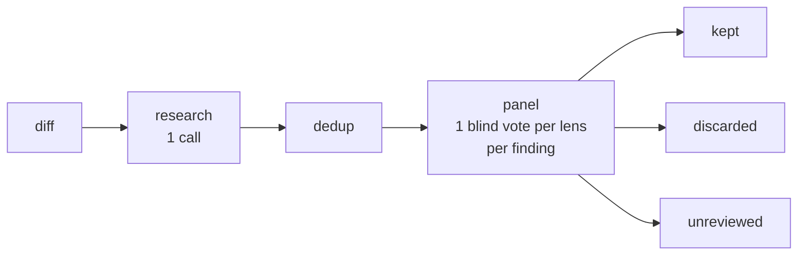

# Quorum :ballot_box:

**Quorum** reviews a diff with several model calls instead of one. A model, the **finder**, reads the diff and proposes candidate findings. Each finding then goes to a **panel** of voters blind to each other, one per **lens**, each asking its own question about it. Whether a finding is kept, and at what confidence, is computed in code from the split of their votes, never reported by a model. What a review looks for is a **profile**: `security` by default, or one you write.

Quorum assists a reviewer; it does not replace human review of untrusted changes. The [Threat model](./30-security/10-threat-model.md) says why, and what it does protect.

Nothing needs reading in order. Pick what you came to do: each track lists its pages in reading order, and every page outside the reference section ends by naming the one that follows it.

## Three tracks

| Track | You want to | Read | Afterwards you can |
| --- | --- | --- | --- |
| **A. Review a diff** | Run quorum on your own changes, at a terminal or in CI | Six pages: Installation, Quick start, The CLI, Configuration, Providers, Local models | Review a diff from a file or a pipe, read its result and its exit code, gate a CI job on that code, and point the finder and the panel at the models you choose, on a server of your own included |
| **B. Use it from code, or review something else** | Call quorum from a TypeScript program, or review for something other than security | Five pages: Profiles, Lenses and policy, Prompts, Library API, The JSON result | Write a profile of your own, choose its lenses and how their votes are graded, run it through `createQuorum` with your providers, and follow a review through its events |
| **C. Know what it protects against** | Decide what quorum can be trusted with before you run it on changes you did not write | Two pages: Threat model, Output handling | Say what an attacker who opens a pull request controls, which controls stand in their way today and what remains, and print a review without letting its text act on your terminal |

### A. Review a diff

1. [Installation](./10-getting-started/10-installation.md) — Node and the npm package, a release binary, the container image, or Bun and the clone, a standalone binary on your `$PATH`, and a check that it works without a model.
2. [Quick start](./10-getting-started/20-quickstart.md) — point it at a model, review a diff, and read the progress, the result and the exit code.
3. [The CLI](./20-using/10-cli.md) — the invocation, what goes to stdout and stderr, every exit code, and what each should do to a CI job.
4. [Configuration](./20-using/20-configuration.md) — the config file and the trust it needs in CI, the `QUORUM_*` variables, how the panel falls back to the finder's settings, the context size each provider states, the keys, `--print-config`, and the errors a bad setting causes.
5. [Providers](./20-using/30-providers.md) — what a provider is, the shipped adapters, the presets, the options a config sets on each, and writing a provider of your own.
6. [Local models](./90-recipes/10-local-models.md) — Ollama, vLLM and llama.cpp: the window each gives a request, choosing a model, and what reasoning mode does to a request.

### B. Use it from code, or review something else

1. [Profiles](./20-using/40-profiles.md) — the security profile, writing your own, running several in one review, gating and guidelines.
2. [Lenses and policy](./20-using/50-lenses-and-policy.md) — the panel's questions, the rules that turn kept votes into a confidence, failed votes, and what a confidence level means.
3. [Prompts](./20-using/60-prompts.md) — the layout of every request, the templates and their variables, the notices, and what is not configurable.
4. [Library API](./95-reference/30-library-api.md) — `createQuorum`, its ports, the events, abort, the errors and every export.
5. [The JSON result](./95-reference/20-json-result.md) — every field of a result, in the order it is written, and the reasons a review is incomplete.

### C. Know what it protects against

1. [Threat model](./30-security/10-threat-model.md) — the attacker, the assets, the residual risk stated plainly, the controls in place today, and what the panel's independence is worth.
2. [Output handling](./30-security/30-output-handling.md) — what the CLI writes and how it is made inert, the advisory flags, and printing a review yourself.

## If you arrive with a job

Start from the work instead of the feature. To gate pull requests in CI, read the [Quick start](./10-getting-started/20-quickstart.md), then [Using it in CI](./20-using/10-cli.md#using-it-in-ci). To put the panel on another model than the finder, or on a hosted API, read [The voter's fallback](./20-using/20-configuration.md#the-voters-fallback). To run it on a server of your own, Ollama, vLLM or llama.cpp, read [Local models](./90-recipes/10-local-models.md). To run it with a config file on pull requests, read [Trust](./20-using/20-configuration.md#trust) first. To read a result someone sent you, [The JSON result](./95-reference/20-json-result.md) has every field. To review for something other than security, start at [Writing a profile](./20-using/40-profiles.md#writing-a-profile). To choose a model or a configuration by measurement, read [Benchmarks](./20-using/70-bench.md). Before you run quorum on a pull request from someone you do not know, read the [Threat model](./30-security/10-threat-model.md).

A word that seems to mean something particular — a lens, a verdict, unreviewed — is defined once in the [glossary](./95-reference/10-glossary.md), with the acronyms these pages assume.

## What you are about to use

Every profile of a review runs the same three stages on the diff, on its own:

Research is one call to the finder, whose reply lists candidate findings. Dedup is plain code that drops a finding repeating the file, line and category of an earlier one. The panel sends every finding to every lens of the profile, one call each, and the verdict follows from the votes.

Three things are worth knowing early:

- **Confidence is arithmetic.** A vote holds `keep` and `reasoning` and nothing else. The profile's policy turns the number of kept votes into a level: with the security profile's three lenses, 3 of 3 is `high`, 2 of 3 is `medium`, and fewer is no level, however sure a voter sounded.
- **Nothing the harness could not review reads as clean.** A finding that a failed vote left undecided is `unreviewed`, and a gap, such as a finding the harness could not read or a request too large for its model's context, is recorded in `meta.incomplete`. Either one makes the review incomplete. For a gating profile the CLI then exits `4`, or `1` when a gating profile also kept a `high` finding, and never `0` unless `--allow-incomplete` lifts the gap, which it never does for a request too large for its model's context. What the harness cannot detect, such as a context size stated above the server's real window, is on the [Threat model](./30-security/10-threat-model.md#what-the-harness-cannot-detect).
- **The code a voter sees is read from the diff by the harness, never taken from the finder.** A finding must cite a line inside a hunk of the diff, its evidence is the diff's lines around that line, and the finder's quote of the code is only compared with them.
